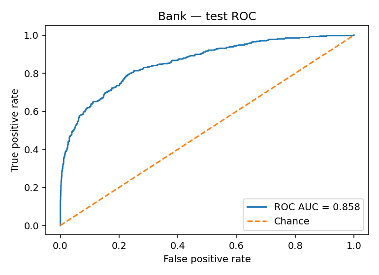
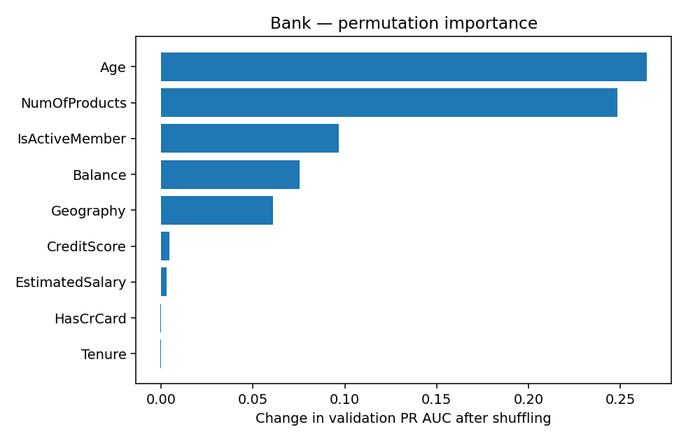
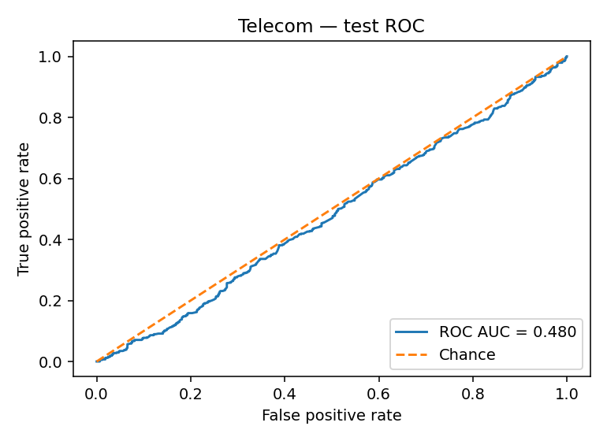

# Churn Intelligence Lab — dual-industry ML portfolio

**Live demo**: A Docker-hosted Gradio + FastAPI application with two separately trained models.  
**How it works**: Bank and telecom customer profiles → in-pipeline imputation/encoding → classifier → thresholded churn screening score.

## Evaluated results (held-out 20% test partition)

| Dataset | Records after dedup | Selected model | ROC AUC | PR AUC | Precision | Recall | F2 | Threshold | Status |
|---|---:|---|---:|---:|---:|---:|---:|---:|---|
| Bank | 10,000 | XGBoost | 0.858 | 0.703 | 0.440 | 0.813 | 0.695 | 0.425 | demonstration |
| Telecom | 5,880 | XGBoost | 0.480 | 0.471 | 0.493 | 1.000 | 0.830 | 0.100 | research_only_low_signal |

**Evaluation protocol:** 64/16/20 train/validation/test stratified splits, fixed random seed, model selection on validation PR AUC; the F2 classification threshold is selected on validation only. The test set remains untouched until final scoring. XGBoost uses training-only 3-fold randomized hyperparameter search.

## Architecture

`train.py` → `models/{bank,telecom}_churn.joblib` + `model_metadata.json` → `app.py` → Docker Space (port 7860) → Gradio UI at `/ui/` + FastAPI Swagger at `/docs`.

### Public API
- `GET /health`: readiness and loaded models
- `GET /api/metadata`: columns, chosen model, test metrics
- `POST /api/predict/bank` or `/api/predict/telecom`: `{"data": {...feature name/value pairs...}}`
- `POST /api/predict-batch/bank` or `/api/predict-batch/telecom`: `{"records": [{...}, {...}]}` (max 100)

**Sample request** (generated safely from defaults in model metadata):
```python
import json, requests
metadata = json.load(open('model_metadata.json'))['datasets']['bank']
payload = {'data': metadata['defaults']}
response = requests.post('https://YOUR-SPACE.hf.space/api/predict/bank', json=payload, timeout=20)
print(response.json())
```

## Reproduce model training
1. Use the Python minor version in the notebook-generated `Dockerfile` (and `model_metadata.json` when published). Install: `pip install -r requirements.txt matplotlib`.
2. Supply `bank_customer_churn.csv` and `customer_churn_data.csv` locally, **never publish raw customer rows**.
3. `python train.py --data-dir /path/to/datasets --project-dir . --tuning-iterations 6`.
4. `python -m pytest -q tests/`; `uvicorn app:app --host 0.0.0.0 --port 7860`.
5. Visit `http://localhost:7860/ui/` and `http://localhost:7860/docs`.

## Evaluation visualizations

**Bank ROC (held-out test)**



**Bank feature importance (validation permutation)**



**Telecom ROC (near-chance baseline)**



## Project layout
- `train.py` — full reusable training and model comparison pipeline
- `app.py` — UI + validated REST endpoints
- `models/` — two **trained**, serialized sklearn-compatible pipelines
- `reports/` — comparison CSV, permutation importance, ROC and confusion matrix graphics
- `model_metadata.json` — measured performance, feature defaults, audits
- `tests/` — API smoke tests
- `Dockerfile`, `requirements.txt` — reproducible runtime
- `MODEL_CARD.md` — model/data limitations and ethics notes
- `notebooks/Customer_Churn_Training_Walkthrough.ipynb` — standalone training walkthrough runnable in Colab
- `.github/workflows/ci.yml` — GitHub Actions CI smoke test

## Limitations and responsible use
Scores are **uncalibrated** probabilities and are not guarantees. A model with near-chance held-out discrimination is flagged `research_only_low_signal`, and its API refuses actionable churn labels. Demonstration datasets may be artificial/educational and do not prove real-world performance; monitor data drift, assess geographic/demographic fairness, calibrate before operational use, and obtain appropriate consent and privacy reviews. The public demo is for **synthetic or anonymized inputs**, with no storage of uploaded customer records as a product feature. Do not submit personal data or use this demo to make automated decisions about people.

*Built in a single Colab notebook from the attached deployment and containerization case studies. All reported results are computed, not estimated.*

## Live hosted project
[Hugging Face Space](https://huggingface.co/spaces/raymuz/Customer_Churn_Intelligence_Lab) • [Web application](https://raymuz-customer-churn-intelligence-lab.hf.space/ui/) • [REST API docs](https://raymuz-customer-churn-intelligence-lab.hf.space/docs)
